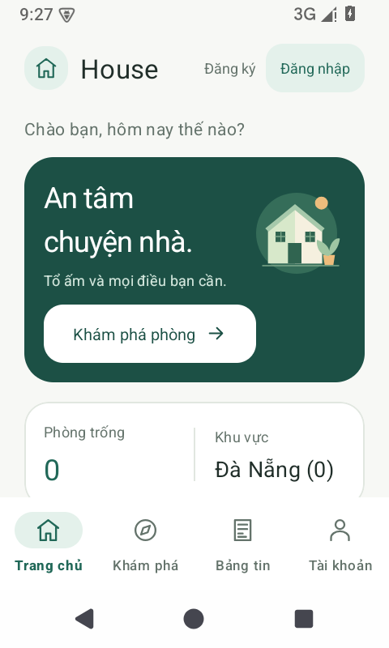
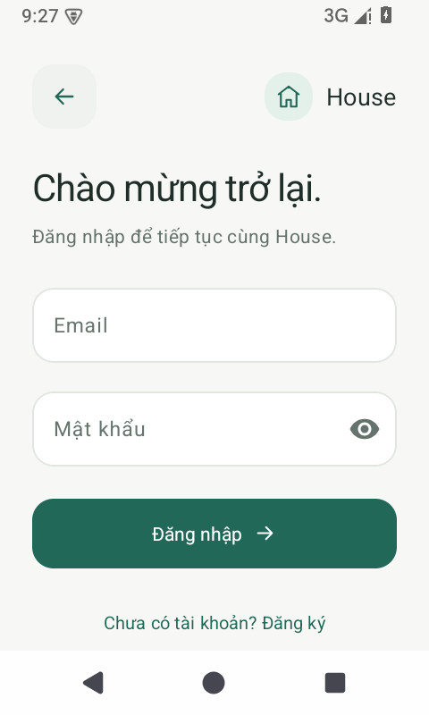
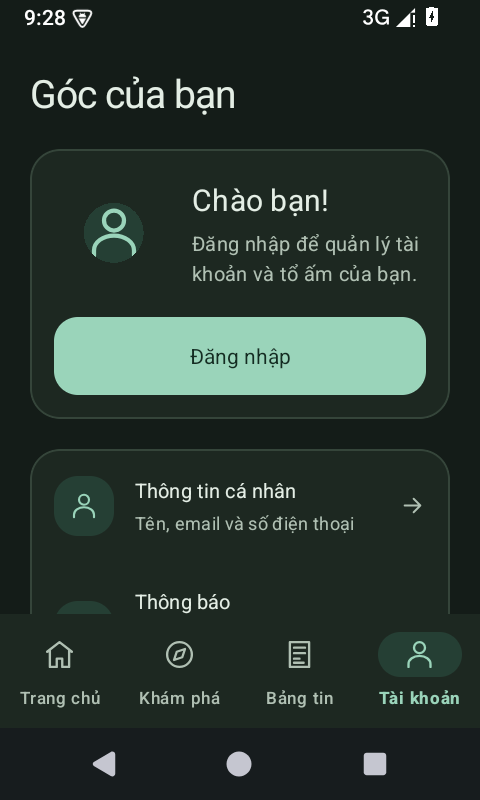

# Giao diện House

Bản làm mới dựa trên `master` tại commit `9585e2d`, gồm các chức năng tài sản, hóa đơn, sửa chữa và bàn giao đã có trong repository.

## Hướng thiết kế

- Xanh trầm làm màu nhấn, nền sáng ấm, chữ có độ tương phản rõ.
- Material 3, thẻ bo góc nhẹ, icon nét và khoảng cách nhất quán.
- Màu sắc được khai báo theo vai trò để giao diện sáng và tối dùng cùng một bố cục.
- Nội dung dài và biểu mẫu có thể cuộn; ô nhập và nút được bố trí để hỗ trợ cỡ chữ lớn.

## Các màn hình chính

Trang chủ có lời chào, minh họa ngôi nhà, nút khám phá, thống kê hiện có và các tiện ích theo vai trò chủ nhà/người thuê. Nhóm tiện ích được hiển thị ngay từ vai trò đã lưu, rồi cập nhật khi dữ liệu tài khoản trả về.

Khám phá phòng và bảng tin có tìm kiếm, nút thêm ở đầu trang và trạng thái tải, trống, không có kết quả hoặc lỗi kết nối. Thẻ phòng dùng một cột trên điện thoại và hai cột khi màn hình đủ rộng.

Đăng nhập, đăng ký và tài khoản có bố cục gọn, nhãn rõ, hỗ trợ điền tự động và nút chuyển tiếp dễ nhận biết. Màn hình tài khoản có lối đăng nhập dành cho khách. Đăng nhập bỏ trống thông tin sẽ báo lỗi ở trường nhập.

Các biểu mẫu, danh sách quản lý, thẻ dữ liệu, chi tiết phòng và trò chuyện dùng chung màu, kiểu chữ, nút và hình dạng. Trợ lý House có gợi ý câu hỏi; chạm gợi ý điền nội dung vào ô soạn trước khi gửi.

`HouseActivity` xử lý khoảng cách thanh hệ thống, bàn phím và màu biểu tượng hệ thống khi thay đổi chế độ sáng/tối. Các ID điều khiển chức năng được giữ lại; banner cũ được thay bằng phần giới thiệu mới.

## Ảnh chụp

Ảnh chụp ở chế độ khách trên Android 35, màn hình 480×800 với mật độ 240.

| Trang chủ | Đăng nhập | Tài khoản nền tối |
| --- | --- | --- |
|  |  |  |

## Kiểm tra

Sau khi nạp môi trường theo [hướng dẫn thiết lập](cloud-environment.md):

```bash
bash gradlew --no-daemon --console=plain \
  :app:assembleDebug :app:assembleDebugAndroidTest \
  :app:testDebugUnitTest :app:lintDebug
```

Trên thiết bị Android đã khởi động:

```bash
ANDROID_SERIAL=emulator-5554 bash gradlew --no-daemon --console=plain \
  :app:connectedDebugAndroidTest
```

`NavigationUiTest` kiểm tra việc mở tìm phòng từ trang chủ và việc báo lỗi khi đăng nhập bỏ trống. Các luồng sử dụng tài khoản Firebase thật, thanh toán và phản hồi Gemini cần được kiểm tra riêng với quyền truy cập dịch vụ phù hợp.

Kết quả trên máy đám mây: build APK thành công; 1 unit test và 3 test Android đạt, không có test bị bỏ qua. Giao diện được kiểm tra trực tiếp ở chế độ sáng/tối, cỡ chữ 130% và khi bàn phím mở. Lint hoàn tất với các cảnh báo còn lại trong báo cáo, không có lỗi chặn build.
