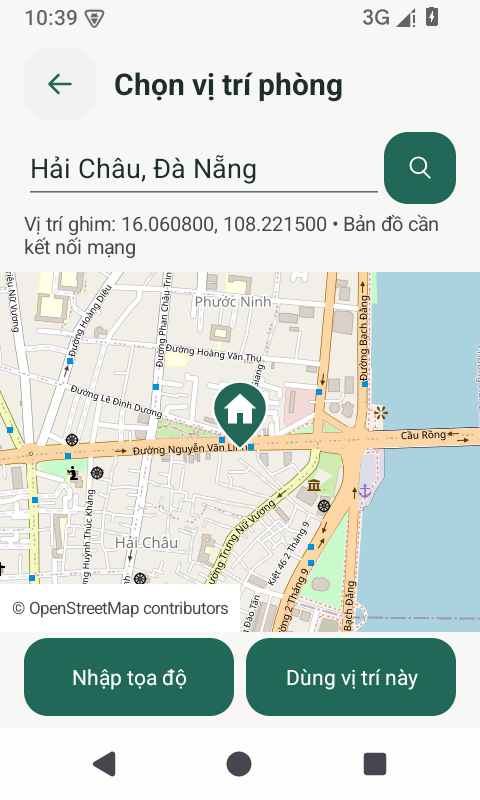

# Tìm phòng, bản đồ và thuê phòng

Nhánh `codex/complete-features-maps` bao gồm giao diện tối giản từ nhánh `codex/modern-minimal-ui` và các chức năng dưới đây.

## Sử dụng

- **Tìm phòng:** tìm theo tên hoặc địa chỉ, có hỗ trợ tiếng Việt không dấu. Bộ lọc kết hợp giá tối thiểu/tối đa, diện tích, phòng còn trống, phòng tôi đăng và sắp xếp theo giá. Phòng chưa có giá hợp lệ không được tính là phòng giá rẻ khi lọc ngân sách.
- **Bản đồ:** vào Khám phá phòng → Bản đồ, hoặc mở chi tiết phòng → Xem vị trí trên bản đồ. Danh sách và bản đồ dùng cùng bộ lọc. Chạm ghim để xem phòng. Chỉ những phòng có tọa độ hợp lệ được ghim; số lượng phòng có vị trí được hiển thị rõ.
- **Đăng/sửa phòng:** tài khoản chủ nhà nhập thông tin, ghim vị trí bằng cách chạm bản đồ hoặc nhập vĩ độ/kinh độ. Có thể tìm địa chỉ nếu thiết bị hỗ trợ Android Geocoder. Đổi địa chỉ cần ghim lại để tránh giữ vị trí cũ. Ảnh là tùy chọn; ảnh được nén và tải lên Firebase Storage khi người dùng chọn ảnh.
- **Chỉ đường:** mở Google Maps hoặc trình duyệt bằng vị trí đã ghim. Tin cũ chưa có tọa độ vẫn có thể mở chỉ đường bằng địa chỉ; cần kiểm tra kết quả tìm địa chỉ trước khi đi.
- **Yêu thích:** trái tim lưu/bỏ lưu phòng theo tài khoản. Xem lại bằng nút Đã lưu hoặc Hồ sơ → Phòng đã lưu.
- **Thuê phòng:** người thuê gửi yêu cầu; xem trạng thái và hủy yêu cầu đang chờ ở Yêu cầu thuê của tôi. Chủ nhà vào Duyệt yêu cầu thuê để liên hệ, chấp thuận hoặc từ chối. Giao dịch kiểm tra lại phòng trên máy chủ và đồng thời cập nhật yêu cầu, người thuê của phòng và biên bản bàn giao. Hai khách không thể cùng được duyệt vào một phòng.
- **Bàn giao:** người thuê đối chiếu tài sản và kiểm tra phòng thực tế rồi xác nhận đã nhận phòng. Chủ nhà theo dõi; không thể ký thay hoặc hủy chữ ký của người thuê. Việc thỏa thuận hợp đồng, tiền cọc và kết thúc hợp đồng thực hiện trực tiếp giữa hai bên.
- **Tin nhắn:** Liên hệ ở chi tiết phòng mở cuộc trò chuyện riêng theo phòng và hai UID; Hồ sơ → Tin nhắn mở hộp thư. Hiển thị 200 tin nhắn gần nhất; nội dung nhập được giữ khi gửi thất bại.
- **Hóa đơn:** chủ nhà chọn phòng đang có người thuê, nhập tháng và các khoản tiền. Mỗi phòng/người thuê/tháng chỉ xuất một hóa đơn. Người thuê bấm Báo đã thanh toán, sau đó chủ nhà kiểm tra tiền thực tế và xác nhận đã nhận tiền. Tổng thu/phải trả tính từ hóa đơn, không dùng số dư mẫu. Chưa tích hợp cổng chuyển tiền trực tuyến.
- **Tài sản/sửa chữa:** tài sản cùng dùng collection `assets`, có mã phòng và UID chủ nhà; lưu lại không tạo bản sao. Người thuê chỉ báo sự cố cho phòng mình đang thuê, xem tiến độ; chủ nhà chỉ xử lý phòng của mình.
- **Hồ sơ/thông báo:** ảnh đại diện được lưu lên Storage; cập nhật hồ sơ không ghi mật khẩu vào Firestore. Thông báo trong ứng dụng tổng hợp trạng thái yêu cầu thuê, hóa đơn và sửa chữa. Tùy chọn hiển thị được lưu trên thiết bị; chưa tích hợp thông báo đẩy FCM.

Bản đồ dùng OpenStreetMap/osmdroid qua HTTPS, giữ ghi nguồn và bộ nhớ đệm của thư viện, không yêu cầu khóa Google Maps hoặc quyền GPS. Bản đồ nền cần mạng. Khi tải nền thất bại, ứng dụng báo lỗi và vẫn giữ tọa độ đã chọn. Không tự đoán tọa độ của phòng cũ từ tên thành phố.

## Cấu hình Firebase thật trước khi dùng

Các kiểm thử dùng dự án giả lập `demo-house`, không ghi dữ liệu vào dự án thật. Chưa triển khai rules lên Firebase thật trong tác vụ này.

1. Trong Firebase Console của dự án gắn với `app/google-services.json`, bật Email/Password trong Authentication, Firestore và Storage. Storage có thể yêu cầu gói thanh toán theo chính sách hiện hành của Firebase; kiểm tra bucket thực tế trong cấu hình ứng dụng.
2. Kiểm tra và bổ sung dữ liệu cũ theo phần dưới trước khi áp dụng rules mới. Rules chặn đọc dữ liệu riêng tư không gắn đúng UID.
3. Đăng nhập Firebase CLI bằng tài khoản có quyền quản lý dự án và triển khai các tệp đã có trong kho mã. Không đưa service account hoặc khóa bí mật vào Git.

Ví dụ trong PowerShell của Android Studio:

```powershell
npm ci --prefix tools/firebase
.\tools\firebase\node_modules\.bin\firebase.cmd login
$projectId = (Get-Content app/google-services.json | ConvertFrom-Json).project_info.project_id
.\tools\firebase\node_modules\.bin\firebase.cmd deploy --project $projectId --only firestore:rules,firestore:indexes,storage
.\gradlew.bat assembleDebug
```

Bản build thông thường dùng cấu hình Firebase hiện có. Cờ `-PuseFirebaseEmulators=true` chỉ bật giả lập cho debug; release luôn dùng cấu hình thật. Không cài bản debug dành cho giả lập lên điện thoại để dùng với dữ liệu thật.

## Dữ liệu cũ

- Phòng chuẩn dùng `hostId`, `hostUid` (tương thích bộ đếm cũ), `tenantUid`, `monthlyPrice`, `latitude`, `longitude` và `status`. Khi đọc, ứng dụng hỗ trợ UID chủ nhà cũ nằm trong `hostUid`.
- Tin đăng không có UID chủ nhà được hiển thị nhưng không cho thuê hoặc liên hệ tới một tài khoản đoán từ họ tên. Quản trị viên phải xác minh chủ sở hữu và bổ sung UID từ Firebase Authentication. Chủ nhà sau đó sửa tin để lưu giá, địa chỉ và tọa độ chuẩn.
- Với phòng đã thuê, hóa đơn, bàn giao, sửa chữa và tài sản cũ, quản trị viên cần đối chiếu để bổ sung `propertyId`, `hostId`, `tenantUid` tương ứng. Không gán dữ liệu tự động theo tên người hoặc tên phòng trùng nhau. Dữ liệu `PropertyAssets` cũ cần chuyển sang `assets` sau khi xác minh phòng/chủ nhà.
- Các tin nhắn trong collection `messages` cũ không có người nhận nên không được đưa vào hộp thư riêng. Bình luận phòng không có `propertyId` cũng không được gắn tùy ý vào một phòng.
- Phiên bản cũ từng có chức năng ghi trường `password` vào hồ sơ. Mã mới đã bỏ hành vi đó; cập nhật hồ sơ/ảnh đại diện xóa trường này của chính tài khoản. Quản trị viên nên xóa các trường mật khẩu cũ còn lại trong `Users`; Firebase Authentication quản lý mật khẩu.

## Kiểm thử lặp lại

Yêu cầu JDK 21, Node 22+, Android SDK 35. Cài đúng phụ thuộc bằng `npm ci --prefix tools/firebase`. Không cần đăng nhập Firebase để chạy giả lập.

```bash
# Kiểm thử rules, không cần thiết bị Android
bash scripts/check-rental-features.sh rules

# Khi thiết bị Android Emulator đã khởi động và sẵn sàng
ANDROID_SERIAL=emulator-5554 bash scripts/check-rental-features.sh all

# APK dùng cấu hình thật, không dùng cờ giả lập
bash gradlew :app:assembleDebug :app:testDebugUnitTest :app:lintDebug
```

Địa chỉ backend từ Android Emulator là `10.0.2.2`, cổng Auth 9099, Firestore 8080, Storage 9199. Chỉ debug cho phép HTTP với các địa chỉ giả lập nội bộ; các dịch vụ bên ngoài vẫn dùng HTTPS. Dữ liệu thử là dữ liệu tạm; không dùng tài khoản thật cho các kịch bản giả lập.

Kiểm tra thủ công sau khi cấu hình dự án thật: đăng một phòng có ghim bằng tài khoản chủ nhà; đăng nhập bằng tài khoản người thuê để lọc, xem bản đồ, lưu phòng, liên hệ và gửi yêu cầu; quay lại chủ nhà duyệt; người thuê kiểm tra tài sản và ký nhận. Kiểm tra Storage bằng một ảnh được chọn trên thiết bị. Kết quả trên Firebase giả lập không xác nhận trạng thái billing, cấu hình bucket hoặc quyền triển khai của dự án thật.

## Kết quả kiểm tra của bản cập nhật

- Build debug và release thành công; bản build thông thường đã kiểm tra có `USE_FIREBASE_EMULATORS=false` ở cả hai biến thể.
- 6 unit tests, 12 kiểm thử Firebase rules và 6 kiểm thử Android đã qua, không có kiểm thử bị bỏ qua trong lần chạy đầy đủ bằng cờ giả lập.
- Kịch bản thuê phòng còn mở các màn hình yêu cầu thuê, phòng đang thuê, bàn giao và hóa đơn; đọc và gửi tin nhắn từ giao diện, kiểm tra dữ liệu đã lưu đúng UID. Kịch bản đã chạy lại thành công sau khi sửa lỗi căn lề bong bóng chat.
- Kiểm tra lại riêng hai kiểm thử bản đồ sau khi hoàn thiện biểu tượng và bố cục: 2/2 qua.
- Lint không có lỗi chặn build; còn các cảnh báo của dự án.
- Nền OpenStreetMap tải và hiển thị qua HTTPS trên thiết bị giả lập; đã xem bố cục dọc, ngang và cỡ chữ 130%. Môi trường cloud cần proxy và CA do nền tảng cung cấp; cấu hình thử chỉ đặt trên AVD, đã khôi phục sau khi kiểm tra.

Ảnh minh họa chọn một vị trí tại Đà Nẵng, không phải vị trí tự suy đoán cho một tin đăng:


